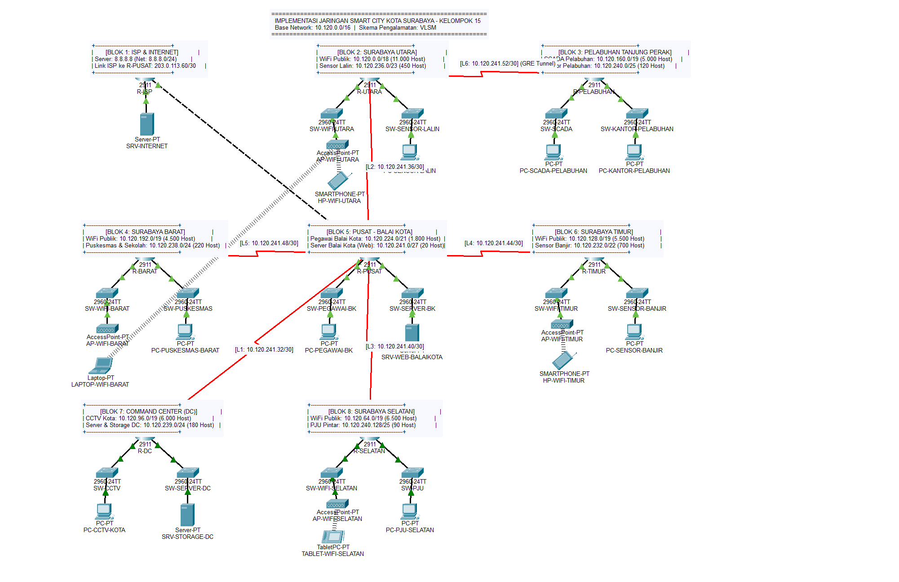
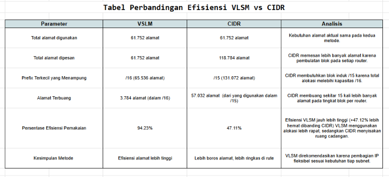
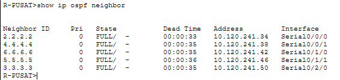
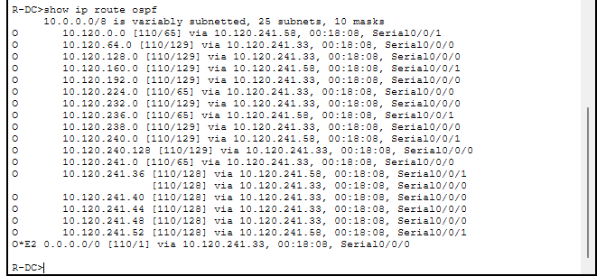
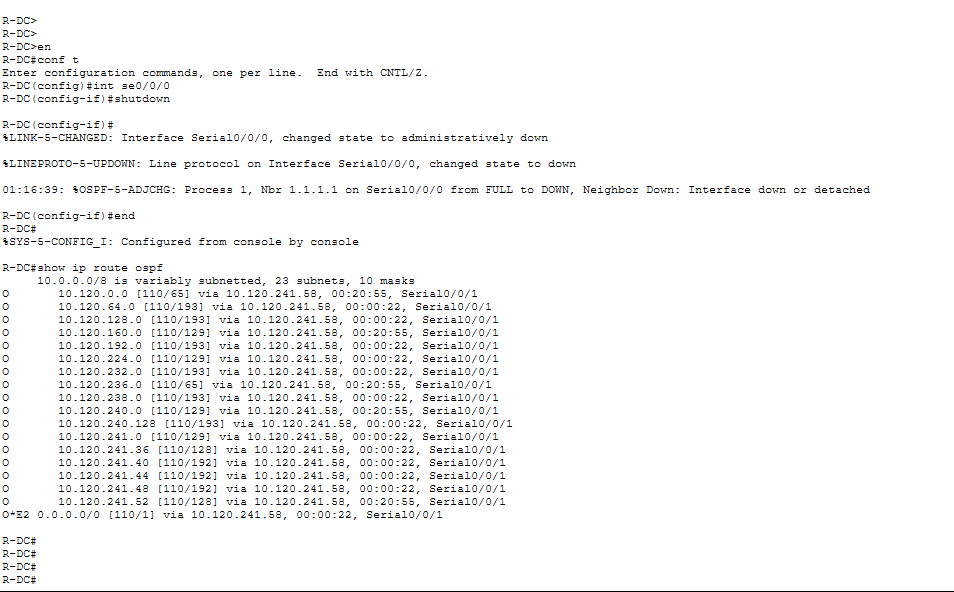

# MidProject Jarkom_K15_005_025_055

## Anggota Kelompok

| Nama                   | NRP        |
| :--------------------- | :--------- |
| Umar | 5027251005 |
| Tafidah Hasna | 5027251025 |
| Keisya Dira Anugerah   | 5027251055 |

## Laporan Dokumentasi


### 1. Topologi dan Skema



**Skema yang digunakan: VLSM**, dengan blok induk `10.120.0.0/16`.


#### Pertimbangan Pemilihan VLSM



> Rincian perhitungan disertakan dalam file spreadsheet [(.xslx)](sps/UTS%20JarKom%20K15.xlsx)

Berdasarkan hasil perhitungan pada spreadsheet, kedua skema memiliki kebutuhan aktual sebesar 61.752 alamat. VLSM dapat menampung kebutuhan tersebut dalam blok induk `/16` yang berkapasitas 65.536 alamat, dengan efisiensi penggunaan sebesar 94,23% dan sisa 3.784 alamat. Sementara itu, skema CIDR yang diuji memerlukan total alokasi 118.784 alamat untuk blok per router, sehingga membutuhkan blok induk `/15` berkapasitas 131.072 alamat.

Dari hasil perbandingan tersebut, VLSM dipilih karena mampu memenuhi kebutuhan alamat IP dalam blok induk yang lebih kecil dengan tingkat pemanfaatan alamat yang lebih tinggi. Pada jaringan yang lebih besar atau memiliki kebutuhan routing berbeda, CIDR dapat menjadi alternatif yang relevan.

---

### 2. Desain Topologi

Topologi berbentuk hub-and-spoke dengan R-PUSAT sebagai hub. 

R-PUSAT terhubung ke 5 router kota lewat link serial, dan ke R-ISP lewat Gigabit Ethernet untuk akses internet. Satu link serial cadangan (R-DC ↔ R-UTARA) dan satu GRE tunnel (R-PUSAT ↔ R-PELABUHAN) melengkapi desain ini.

#### 2.1 Daftar Router dan LAN

| Router | LAN 1 | LAN 2 | Keterangan |
| :-- | :-- | :-- | :-- |
| R-ISP | 8.8.8.0/24 (SRV-INTERNET) | – | Simulasi internet |
| R-PUSAT | 10.120.224.0/21 (Pegawai Balai Kota) | 10.120.241.0/27 (SRV-WEB-BALAIKOTA) | Hub, DHCP, NAT, gateway ke ISP |
| R-DC | 10.120.96.0/19 (CCTV Kota) | 10.120.239.0/24 (SRV-STORAGE-DC: DNS + DHCP) | Data center |
| R-BARAT | 10.120.192.0/19 (WiFi Barat) | 10.120.238.0/24 (Puskesmas) | |
| R-UTARA | 10.120.0.0/18 (WiFi Utara) | 10.120.236.0/23 (Sensor Lalu Lintas) | |
| R-TIMUR | 10.120.128.0/19 (WiFi Timur) | 10.120.232.0/22 (Sensor Banjir) | |
| R-SELATAN | 10.120.64.0/19 (WiFi Selatan) | 10.120.240.128/25 (PJU) | |
| R-PELABUHAN | 10.120.160.0/19 (SCADA) | 10.120.240.0/25 (Kantor Pelabuhan) | Terhubung ke R-UTARA dan tunnel ke R-PUSAT |

#### 2.2 Daftar Link 

| Link | Subnet | Sisi A | Sisi B | Keterangan |
| :-- | :-- | :-- | :-- | :-- |
| L1 PUSAT-DC | 10.120.241.32/30 | PUSAT Se0/0/0 = .33 (DCE) | DC Se0/0/0 = .34 | |
| L2 PUSAT–UTARA | 10.120.241.36/30 | PUSAT Se0/0/1 = .37 (DCE) | UTARA Se0/0/0 = .38 | |
| L3 PUSAT-SELATAN | 10.120.241.40/30 | PUSAT Se0/1/0 = .41 (DCE) | SELATAN Se0/0/0 = .42 | |
| L4 PUSAT-TIMUR | 10.120.241.44/30 | PUSAT Se0/1/1 = .45 (DCE) | TIMUR Se0/0/0 = .46 | |
| L5 PUSAT-BARAT | 10.120.241.48/30 | PUSAT Se0/2/0 = .49 (DCE) | BARAT Se0/0/0 = .50 | |
| L6 UTARA-PELABUHAN | 10.120.241.52/30 | UTARA Se0/0/1 = .53 (DCE) | PELABUHAN Se0/0/0 = .54 | |
| L7 Cadangan DC-UTARA | 10.120.241.56/30 | DC Se0/0/1 = .57 (DCE) | UTARA Se0/1/0 = .58 | Aktif di versi OSPF |
| Uplink ISP | 203.0.113.60/30 | PUSAT Gi0/0 = .61 | ISP Gi0/0 = .62 | NAT outside |
| ISP–Internet | 8.8.8.0/24 | ISP Gi0/1 = 8.8.8.1 | SRV-INTERNET = 8.8.8.8 | |
| Tunnel GRE | 192.168.15.0/30 | PUSAT Tunnel0 = .1 | PELABUHAN Tunnel0 = .2 | Menembus jaringan serial |

Semua blok `10.120.0.0/16` terpakai tanpa tumpang tindih: blok besar (/18, /19, /21) untuk LAN WiFi dan pegawai, blok menengah (/22–/25) untuk LAN sensor dan layanan, dan /30 untuk link point-to-point. Itulah keuntungan VLSM dibanding pembagian sama rata.

---


### 3. Konfigurasi

Pengalamatan IP mengikuti tabel bagian 2. Setiap interface router memakai IP statis (`ip address ...`, `no shutdown`, dan `clock rate 64000` di sisi DCE), dan semua server memakai IP statis.

| Server | IP | Gateway |
| :-- | :-- | :-- |
| SRV-INTERNET | 8.8.8.8/24 | 8.8.8.1 |
| SRV-WEB-BALAIKOTA | 10.120.241.2/27 | 10.120.241.1 |
| SRV-STORAGE-DC | 10.120.239.2/24 | 10.120.239.1 |


#### 3.1 Static Routing

Dilakukan agar semua LAN saling terhubung hanya dengan static route. Default route hanya mengarah ke atas (keluar), dan R-PUSAT serta R-UTARA wajib punya route ke jaringan di bawahnya.

| Router | Default route (arah keluar) |
| :-- | :-- |
| R-PUSAT | `ip route 0.0.0.0 0.0.0.0 203.0.113.62` (ke R-ISP) |
| R-DC | `ip route 0.0.0.0 0.0.0.0 10.120.241.33` (ke R-PUSAT) |
| R-BARAT | `ip route 0.0.0.0 0.0.0.0 10.120.241.49` (ke R-PUSAT) |
| R-TIMUR | `ip route 0.0.0.0 0.0.0.0 10.120.241.45` (ke R-PUSAT) |
| R-SELATAN | `ip route 0.0.0.0 0.0.0.0 10.120.241.41` (ke R-PUSAT) |
| R-UTARA | `ip route 0.0.0.0 0.0.0.0 10.120.241.37` (ke R-PUSAT) |
| R-PELABUHAN | `ip route 0.0.0.0 0.0.0.0 10.120.241.53` (ke R-UTARA) |

```
! R-PUSAT: route ke jaringan di bawahnya
ip route 10.120.96.0    255.255.224.0   10.120.241.34   ! LAN CCTV (R-DC)
ip route 10.120.239.0   255.255.255.0   10.120.241.34   ! LAN Server & Storage DC (R-DC)
ip route 10.120.192.0   255.255.224.0   10.120.241.50   ! WiFi Barat (R-BARAT)
ip route 10.120.238.0   255.255.255.0   10.120.241.50   ! Puskesmas (R-BARAT)
ip route 10.120.0.0     255.255.192.0   10.120.241.38   ! WiFi Utara (R-UTARA)
ip route 10.120.236.0   255.255.254.0   10.120.241.38   ! Sensor Lalu Lintas (R-UTARA)
ip route 10.120.241.52  255.255.255.252 10.120.241.38   ! Link R-UTARA - R-PELABUHAN
ip route 10.120.128.0   255.255.224.0   10.120.241.46   ! WiFi Timur (R-TIMUR)
ip route 10.120.232.0   255.255.252.0   10.120.241.46   ! Sensor Banjir (R-TIMUR)
ip route 10.120.64.0    255.255.224.0   10.120.241.42   ! WiFi Selatan (R-SELATAN)
ip route 10.120.240.128 255.255.255.128 10.120.241.42   ! PJU (R-SELATAN)
ip route 10.120.160.0   255.255.224.0   192.168.15.2    ! SCADA (R-PELABUHAN) via tunnel
ip route 10.120.240.0   255.255.255.128 192.168.15.2    ! Kantor Pelabuhan via tunnel

! R-UTARA: route ke LAN R-PELABUHAN
ip route 10.120.160.0   255.255.224.0   10.120.241.54
ip route 10.120.240.0   255.255.255.128 10.120.241.54

! R-PELABUHAN: route ke pusat lewat tunnel (lihat 3.4)
ip route 10.120.224.0   255.255.248.0   192.168.15.1
ip route 10.120.241.0   255.255.255.224 192.168.15.1
```

| Perintah | Arti |
| :-- | :-- |
| `ip route <tujuan> <mask> <next-hop>` | Mengarahkan paket ke jaringan tujuan lewat router next-hop. |
| `ip route 0.0.0.0 0.0.0.0 <next-hop>` | Default route untuk semua tujuan yang tidak ada di tabel. Hanya diarahkan ke router di atasnya. |

Setiap router cabang cukup memakai default route karena semua tujuan lain berada "di atas" (R-PUSAT). R-PUSAT menjadi satu-satunya router yang tahu semua LAN.

#### 3.2 DHCP

**Tujuan:** perangkat pengguna mendapat IP, gateway, dan DNS otomatis. Khusus LAN CCTV Kota, IP berasal dari server DHCP di LAN Server dan Storage DC.

| Router | Pool | Jaringan | Gateway | DNS |
| :-- | :-- | :-- | :-- | :-- |
| R-PUSAT | POOL-PEGAWAI-BK | 10.120.224.0/21 | 10.120.224.1 | 10.120.239.2 |
| R-BARAT | POOL-WIFI-BARAT | 10.120.192.0/19 | 10.120.192.1 | 10.120.239.2 |
| R-BARAT | POOL-PUSKESMAS-BARAT | 10.120.238.0/24 | 10.120.238.1 | 10.120.239.2 |
| R-UTARA | POOL-WIFI-UTARA | 10.120.0.0/18 | 10.120.0.1 | 10.120.239.2 |
| R-UTARA | POOL-SENSOR-LALIN | 10.120.236.0/23 | 10.120.236.1 | 10.120.239.2 |
| R-TIMUR | POOL-WIFI-TIMUR | 10.120.128.0/19 | 10.120.128.1 | 10.120.239.2 |
| R-TIMUR | POOL-SENSOR-BANJIR | 10.120.232.0/22 | 10.120.232.1 | 10.120.239.2 |
| R-SELATAN | POOL-WIFI-SELATAN | 10.120.64.0/19 | 10.120.64.1 | 10.120.239.2 |
| R-SELATAN | POOL-PJU-SELATAN | 10.120.240.128/25 | 10.120.240.129 | 10.120.239.2 |
| R-PELABUHAN | POOL-SCADA-PELABUHAN | 10.120.160.0/19 | 10.120.160.1 | 10.120.239.2 |
| R-PELABUHAN | POOL-KANTOR-PELABUHAN | 10.120.240.0/25 | 10.120.240.1 | 10.120.239.2 |

```
! Contoh R-PUSAT (pola sama untuk router lain)
R-PUSAT(config)# ip dhcp excluded-address 10.120.224.1 10.120.224.5
R-PUSAT(config)# ip dhcp pool POOL-PEGAWAI-BK
R-PUSAT(dhcp-config)# network 10.120.224.0 255.255.248.0
R-PUSAT(dhcp-config)# default-router 10.120.224.1
R-PUSAT(dhcp-config)# dns-server 10.120.239.2

! LAN CCTV: DHCP dari server SRV-STORAGE-DC (bukan dari router)
R-DC(config)# interface GigabitEthernet0/0
R-DC(config-if)# ip helper-address 10.120.239.2
```

Di SRV-STORAGE-DC: **Services → DHCP → On**, pool `serverPool` dengan Network 10.120.96.0/19, Default Gateway 10.120.96.1, DNS Server 10.120.239.2, Start IP 10.120.96.6, lalu **Save**.

| Perintah | Arti |
| :-- | :-- |
| `ip dhcp excluded-address A B` | IP .1–.5 tidak dibagikan, dicadangkan untuk gateway dan perangkat tetap. |
| `ip dhcp pool` / `network` | Membuat pool dan menentukan subnet yang dilayani. |
| `default-router` / `dns-server` | Gateway dan DNS yang diberikan ke klien. |
| `ip helper-address 10.120.239.2` | Mengubah broadcast DHCP klien CCTV menjadi unicast ke server DHCP di LAN lain. Tanpa ini broadcast tidak melewati router. |

#### 3.3 Soal 5 – NAT

**Tujuan:** semua host mengakses 8.8.8.8 dengan satu IP publik milik R-PUSAT (203.0.113.61). R-ISP tidak punya rute ke alamat privat.

```
R-PUSAT(config)# access-list 1 permit 10.120.0.0 0.0.255.255
R-PUSAT(config)# access-list 1 permit 192.168.15.0 0.0.0.3
R-PUSAT(config)# interface GigabitEthernet0/0
R-PUSAT(config-if)# ip nat outside
R-PUSAT(config)# interface range GigabitEthernet0/1 - 2
R-PUSAT(config-if-range)# ip nat inside
R-PUSAT(config)# interface range Serial0/0/0 - Serial0/2/0
R-PUSAT(config-if-range)# ip nat inside
R-PUSAT(config)# ip nat inside source list 1 interface GigabitEthernet0/0 overload
```

| Perintah | Arti |
| :-- | :-- |
| `access-list 1 permit ...` | Daftar sumber yang boleh di-NAT: seluruh 10.120.0.0/16 dan subnet tunnel. |
| `ip nat inside` / `outside` | Menandai sisi dalam (LAN dan serial) dan sisi luar (ke ISP). |
| `ip nat inside source list 1 interface Gi0/0 overload` | PAT: semua alamat privat diterjemahkan menjadi satu IP Gi0/0, dibedakan lewat nomor port. |

R-ISP hanya memiliki dua interface (203.0.113.62/30 dan 8.8.8.1/24) tanpa static route atau protokol routing. Balasan ke 203.0.113.61 sampai karena subnet itu terhubung langsung (connected). Jadi R-ISP tidak pernah menyimpan alamat privat 10.120.x.x.

#### 3.4 Soal 6 – GRE Tunnel R-PUSAT ↔ R-PELABUHAN

```
R-PUSAT(config)# interface Tunnel0
R-PUSAT(config-if)# ip address 192.168.15.1 255.255.255.252
R-PUSAT(config-if)# mtu 1476
R-PUSAT(config-if)# tunnel source Serial0/0/1
R-PUSAT(config-if)# tunnel destination 10.120.241.54

R-PELABUHAN(config)# interface Tunnel0
R-PELABUHAN(config-if)# ip address 192.168.15.2 255.255.255.252
R-PELABUHAN(config-if)# mtu 1476
R-PELABUHAN(config-if)# tunnel source Serial0/0/0
R-PELABUHAN(config-if)# tunnel destination 10.120.241.37
```

Route yang memaksa lalu lintas melewati tunnel sudah tertulis di 3.1:
- R-PUSAT → SCADA dan Kantor Pelabuhan lewat `192.168.15.2`.
- R-PELABUHAN → LAN Pegawai Balai Kota (10.120.224.0/21) dan Server Balai Kota (10.120.241.0/27) lewat `192.168.15.1`.

| Perintah | Arti |
| :-- | :-- |
| `interface Tunnel0` | Interface virtual; mode bawaan adalah GRE over IP. |
| `ip address 192.168.15.x/30` | Alamat di dalam tunnel (subnet khusus 2 host). |
| `tunnel source` / `tunnel destination` | Alamat ujung luar (underlay) tempat paket GRE dikirim. Harus saling terjangkau. |
| `mtu 1476` | MTU turun 24 byte untuk header GRE supaya paket tidak terfragmentasi. |

**Mengapa router memilih jalur tunnel dibanding jalur lain ke pelabuhan?**
1. **Longest prefix match.** Di R-PUSAT, satu-satunya route ke LAN Pelabuhan (`10.120.160.0/19` dan `10.120.240.0/25`) adalah yang menunjuk ke `192.168.15.2`. Route lain yang menuju arah Pelabuhan hanya `10.120.241.52/30` (hanya subnet link) dan default ke ISP (`/0`, paling tidak spesifik). Di R-PELABUHAN, route ke `10.120.224.0/21` dan `10.120.241.0/27` lebih spesifik daripada default route ke R-UTARA (`/0`), sehingga yang dipilih adalah route tunnel.
2. **Administrative distance.** Pada file OSPF, jalur lewat R-UTARA juga dipelajari OSPF (AD 110), tetapi static route ke tunnel (AD 1) lebih dipercaya, jadi tetap menang.
3. **Jalur fisik tidak berubah.** Paket GRE tetap melewati link R-PUSAT – R-UTARA – R-PELABUHAN (underlay). Tunnel hanya menyediakan jalur logis point-to-point 192.168.15.0/30 yang dipakai tabel routing.

**Mengapa GRE saja tidak mengenkripsi data?** GRE hanya *encapsulation*: paket asli dibungkus header GRE (protokol IP 47) lalu dikirim lewat IP biasa. GRE tidak punya fitur kerahasiaan (enkripsi), integritas, maupun autentikasi. Isi paket asli tetap berupa plaintext dan bisa dibaca oleh router atau perangkat mana pun yang dilewati (di sini R-UTARA), misalnya lewat Simulation Mode. Enkripsi harus ditambahkan oleh protokol lain, yaitu IPsec.

**Keterbatasan desain:** `tunnel source` memakai Serial0/0/1 (satu interface fisik). Bila link L2 R-PUSAT–R-UTARA putus, tunnel di sisi R-PUSAT ikut down, sedangkan GRE tanpa keepalive membuat tunnel di sisi R-PELABUHAN tetap "up", sehingga lalu lintas ke Balai Kota bisa terbuang. Perbaikannya adalah memakai interface Loopback sebagai tunnel source dan mengiklankannya di OSPF, atau mengaktifkan `keepalive` pada tunnel.

**Bonus IPsec (opsional, tidak ada di file .pkt; kerjakan hanya jika mau mengambil bonus +5):**

```
! Pada kedua router (ganti peer sesuai arah)
R-PUSAT(config)# crypto isakmp policy 10
R-PUSAT(config-isakmp)# encryption aes
R-PUSAT(config-isakmp)# hash sha
R-PUSAT(config-isakmp)# authentication pre-share
R-PUSAT(config-isakmp)# group 2
R-PUSAT(config)# crypto isakmp key K15KEY address 10.120.241.54
R-PUSAT(config)# crypto ipsec transform-set TS esp-aes esp-sha-hmac
R-PUSAT(cfg-crypto-trans)# mode transport
R-PUSAT(config)# crypto map CMAP 10 ipsec-isakmp
R-PUSAT(config-crypto-map)# set peer 10.120.241.54
R-PUSAT(config-crypto-map)# set transform-set TS
R-PUSAT(config-crypto-map)# match address 100
R-PUSAT(config)# access-list 100 permit gre host 10.120.241.37 host 10.120.241.54
R-PUSAT(config)# interface Serial0/0/1
R-PUSAT(config-if)# crypto map CMAP
! R-PELABUHAN: peer 10.120.241.37, ACL: permit gre host 10.120.241.54 host 10.120.241.37, crypto map di Serial0/0/0
```

#### 3.5 Soal 7 – Dynamic Routing OSPF (file `K15_VLSM_OSPF.pkt`)

**Link cadangan L7 R-DC ↔ R-UTARA:** subnet `10.120.241.56/30` (belum dipakai, berada di blok WAN).

```
R-DC(config)# interface Serial0/0/1
R-DC(config-if)# description L7 Cadangan to R-UTARA
R-DC(config-if)# ip address 10.120.241.57 255.255.255.252
R-DC(config-if)# clock rate 64000
R-DC(config-if)# no shutdown

R-UTARA(config)# interface Serial0/1/0
R-UTARA(config-if)# description L7 Cadangan to R-DC
R-UTARA(config-if)# ip address 10.120.241.58 255.255.255.252
R-UTARA(config-if)# no shutdown
```

(Di topologi, clock rate dipasang di sisi DCE kabel; sesuaikan bila kabelmu DCE di sisi R-UTARA.)

**Penghapusan static route:** seluruh static route antar-router dan semua default route di router cabang dihapus. Yang tersisa hanya default route R-PUSAT ke ISP dan static route tunnel dari soal 6.

**Konfigurasi OSPF (proses 1, area 0):**

```
R-PUSAT(config)# router ospf 1
R-PUSAT(config-router)# router-id 1.1.1.1
R-PUSAT(config-router)# passive-interface GigabitEthernet0/1
R-PUSAT(config-router)# passive-interface GigabitEthernet0/2
R-PUSAT(config-router)# network 10.120.224.0 0.0.7.255 area 0
R-PUSAT(config-router)# network 10.120.241.0 0.0.0.31 area 0
R-PUSAT(config-router)# network 10.120.241.32 0.0.0.3 area 0
R-PUSAT(config-router)# network 10.120.241.36 0.0.0.3 area 0
R-PUSAT(config-router)# network 10.120.241.40 0.0.0.3 area 0
R-PUSAT(config-router)# network 10.120.241.44 0.0.0.3 area 0
R-PUSAT(config-router)# network 10.120.241.48 0.0.0.3 area 0
R-PUSAT(config-router)# default-information originate
```

| Router | router-id | Passive interface | `network ... area 0` |
| :-- | :-- | :-- | :-- |
| R-DC | 2.2.2.2 | Gi0/0, Gi0/1 | 10.120.96.0 0.0.31.255; 10.120.239.0 0.0.0.255; 10.120.241.32 0.0.0.3; 10.120.241.56 0.0.0.3 |
| R-BARAT | 3.3.3.3 | Gi0/0, Gi0/1 | 10.120.192.0 0.0.31.255; 10.120.238.0 0.0.0.255; 10.120.241.48 0.0.0.3 |
| R-UTARA | 4.4.4.4 | Gi0/0, Gi0/1 | 10.120.0.0 0.0.63.255; 10.120.236.0 0.0.1.255; 10.120.241.36 0.0.0.3; 10.120.241.52 0.0.0.3; 10.120.241.56 0.0.0.3 |
| R-TIMUR | 5.5.5.5 | Gi0/0, Gi0/1 | 10.120.128.0 0.0.31.255; 10.120.232.0 0.0.3.255; 10.120.241.44 0.0.0.3 |
| R-SELATAN | 6.6.6.6 | Gi0/0, Gi0/1 | 10.120.64.0 0.0.31.255; 10.120.240.128 0.0.0.127; 10.120.241.40 0.0.0.3 |
| R-PELABUHAN | 7.7.7.7 | Gi0/0, Gi0/1 | 10.120.160.0 0.0.31.255; 10.120.240.0 0.0.0.127; 10.120.241.52 0.0.0.3 |

| Perintah | Arti |
| :-- | :-- |
| `router ospf 1` / `router-id` | Mengaktifkan OSPF dan menetapkan ID router secara manual. |
| `network <net> <wildcard> area 0` | Interface dengan IP di rentang itu ikut OSPF dan diiklankan di area 0. Wildcard = kebalikan mask (/19 → 0.0.31.255). |
| `passive-interface` | Jaringan LAN tetap diiklankan, tetapi **tidak mengirim pesan OSPF Hello ke arah LAN pengguna** (sesuai ketentuan). |
| `default-information originate` | Hanya R-PUSAT yang membuat default route (dari `ip route 0.0.0.0 ...` ke ISP) lalu menyebarkannya ke router lain, yang menerimanya otomatis sebagai `O*E2`. |

**Pemulihan otomatis:** L7 membuat R-DC dan R-UTARA saling terhubung, sehingga ada dua jalur ke R-PUSAT. Bila L1 (R-PUSAT–R-DC) putus, R-DC mencapai R-PUSAT lewat R-UTARA. Bila L2 (R-PUSAT–R-UTARA) putus, R-UTARA dan R-PELABUHAN mencapai R-PUSAT lewat R-DC. OSPF menghitung ulang route sehingga konektivitas pulih tanpa campur tangan manual. Link yang menghubungkan satu router saja ke R-PUSAT (BARAT, TIMUR, SELATAN) tidak memiliki cadangan.

#### 3.6 Soal 8 – Layanan Aplikasi Smart City (domain `k15.smartcity.lab`)

**a. DNS (SRV-STORAGE-DC → Services → DNS → On):**

| Name | Type | Address |
| :-- | :-- | :-- |
| k15.smartcity.lab | A | 10.120.241.2 |
| www.k15.smartcity.lab | A | 10.120.241.2 |
| ftp.k15.smartcity.lab | A | 10.120.239.2 |
| mail.k15.smartcity.lab | A | 10.120.239.2 |

DNS server ini (10.120.239.2) diberikan lewat DHCP ke seluruh wilayah, sehingga nama `www`, `ftp`, dan `mail` bisa dipakai dari mana pun.

**b. Web Balai Kota (SRV-WEB-BALAIKOTA → Services → HTTP → On):** `index.html` diubah menjadi halaman **"Portal Smart City Surabaya - Kelompok 15"** dengan teks "Selamat Datang di Portal Resmi Smart City Pemerintah Kota Surabaya (Kelompok 15)". Halaman dibuka dengan `http://www.k15.smartcity.lab` dari semua wilayah.

**c. FTP rekaman CCTV (SRV-STORAGE-DC → Services → FTP → On):** akun login `cctv` / `cctv123` dengan hak Write, Read, Delete, Rename, List. Dari PC-CCTV-KOTA, file diunggah dengan:

```
C:\> ftp ftp.k15.smartcity.lab
Username: cctv
Password: cctv123
ftp> put rekaman.txt
ftp> dir
```

**d. Email antarpegawai (SRV-STORAGE-DC → Services → EMAIL → SMTP & POP3 On):**
- Domain Name: `k15.smartcity.lab` → klik **Set**.
- Akun: `pegawai` / `pegawai123` dan `pelabuhan` / `pelabuhan123`.
- PC-PEGAWAI-BK → **Desktop → Email → Configure Mail**: Your Name `Pegawai`, Email Address `pegawai@k15.smartcity.lab`, Incoming dan Outgoing Mail Server `mail.k15.smartcity.lab`, User Name `pegawai`, Password `pegawai123`.
- PC-KANTOR-PELABUHAN dengan konfigurasi sama, memakai akun `pelabuhan@k15.smartcity.lab` / `pelabuhan123`.

---

### 4. Pengujian Mandiri

> Hasil di bawah adalah hasil yang diharapkan dari konfigurasi. Ganti dengan screenshot hasil di Packet Tracer milikmu.

#### 4.1 Soal 3 – Static Routing

| Perintah | Hasil |
| :-- | :-- |
| `show ip route static` di R-PUSAT | Baris `S` ke semua LAN cabang (via .34, .38, .42, .46, .50 dan 192.168.15.2), serta `S* 0.0.0.0/0 [1/0] via 203.0.113.62`. |
| `show ip route static` di R-UTARA | `S*` default ke 10.120.241.37 dan `S` ke 10.120.160.0/19 dan 10.120.240.0/25 via 10.120.241.54. |
| `show ip route` di R-DC, R-PELABUHAN | Hanya default route (R-PELABUHAN juga route tunnel). |
| `ping` PC-PJU-SELATAN → PC-SENSOR-BANJIR | Reply. |
| `ping` PC-SCADA-PELABUHAN → PC-CCTV-KOTA | Reply. |


#### 4.2 Soal 4 – DHCP

| Perintah | Hasil |
| :-- | :-- |
| `ipconfig` di PC-PEGAWAI-BK | IP dari 10.120.224.0/21 (mulai .6), gateway 10.120.224.1, DNS 10.120.239.2. |
| `ipconfig` di PC-CCTV-KOTA | IP dari 10.120.96.0/19 (mulai .6), gateway 10.120.96.1, DNS 10.120.239.2. Pool berasal dari server (bukan router). |
| `show ip dhcp binding` di R-PUSAT | Ada binding untuk PC Pegawai BK; tidak ada binding untuk CCTV. |


#### 4.3 Soal 5 – NAT

| Perintah | Hasil |
| :-- | :-- |
| `ping 8.8.8.8` dari PC Pegawai, CCTV, SCADA | Reply. |
| `show ip nat translations` di R-PUSAT | Inside global 203.0.113.61:port dengan inside local 10.120.x.x. |
| `show ip route` di R-ISP | Hanya `C`/`L` untuk 203.0.113.60/30 dan 8.8.8.0/24, tanpa route 10.120.0.0/16. |


#### 4.4 Soal 6 – GRE Tunnel

| Perintah | Hasil |
| :-- | :-- |
| `show interface tunnel 0` di R-PUSAT | `Tunnel0 is up, line protocol is up`, source 10.120.241.37, destination 10.120.241.54, protocol GRE/IP. |
| `ping 192.168.15.2` dari R-PUSAT | `!!!!!` |
| `tracert` PC-SCADA-PELABUHAN → PC-PEGAWAI-BK | Hop: 10.120.160.1 → 192.168.15.1 → PC tujuan (melewati tunnel). |
| `tracert` PC-PEGAWAI-BK → PC-SCADA-PELABUHAN | Hop: 10.120.224.1 → 192.168.15.2 → PC tujuan. |
| Simulation Mode: ping PC Pegawai → SCADA, klik PDU di R-UTARA | Di *Outbound PDU Details* terlihat header GRE dengan isi paket asli tidak terenkripsi (membuktikan GRE tanpa enkripsi). |


#### 4.5 Soal 7 – OSPF (file `K15_VLSM_OSPF.pkt`)

| Perintah | Hasil |
| :-- | :-- |
| `show ip ospf neighbor` di R-PUSAT | 5 neighbor `FULL` (2.2.2.2, 3.3.3.3, 4.4.4.4, 5.5.5.5, 6.6.6.6). |
| `show ip ospf neighbor` di R-UTARA | Neighbor 1.1.1.1, 2.2.2.2 (lewat L7), dan 7.7.7.7 berstatus `FULL`. |
| `show ip route ospf` di R-DC | Route `O` ke LAN cabang dan `O*E2 0.0.0.0/0 via 10.120.241.33`. |
| `show ip protocols` | `ospf 1`, router-id sesuai, passive interface = LAN pengguna. |
| `ping 8.8.8.8` dari PC-CCTV-KOTA | Reply (default route berasal dari OSPF). |
| `show running-config \| section router ospf` di R-DC | Tidak ada `ip route 0.0.0.0` (default hanya di R-PUSAT). |
| Failover: `shutdown` Se0/0/0 R-DC, tunggu ±40 detik, `show ip route ospf`, ping dari PC Pegawai ke PC-CCTV-KOTA | Route default R-DC berpindah via 10.120.241.58 (R-UTARA) dan ping tetap berhasil. |





#### 4.6 Soal 8 – Layanan Aplikasi

| Pengujian | Hasil |
| :-- | :-- |
| `ping www.k15.smartcity.lab` dari PC di tiap wilayah | Terjawab 10.120.241.2 dan Reply. |
| `nslookup ftp.k15.smartcity.lab` / `mail.k15.smartcity.lab` | 10.120.239.2. |
| Web Browser → `http://www.k15.smartcity.lab` dari PC Pegawai, WiFi Selatan, SCADA | Halaman "Portal Smart City Surabaya - Kelompok 15". |
| FTP dari PC-CCTV-KOTA (`ftp ftp.k15.smartcity.lab`, `put`) | Login berhasil dan file terunggah; `dir` menampilkan file. |
| Email: PC-PEGAWAI-BK kirim ke `pelabuhan@k15.smartcity.lab`, PC-KANTOR-PELABUHAN **Receive**, lalu balas | Surat terkirim dan diterima di kedua arah. |


